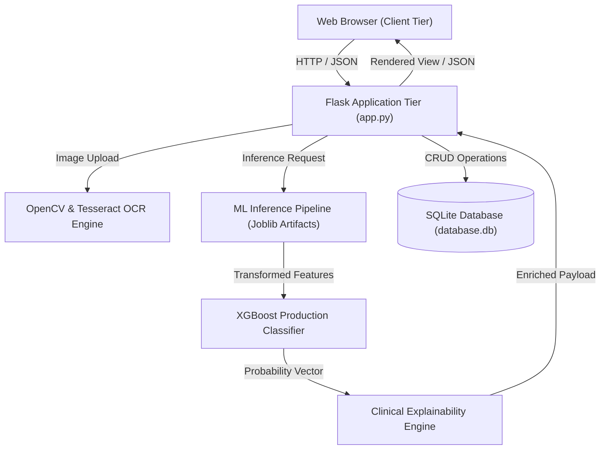
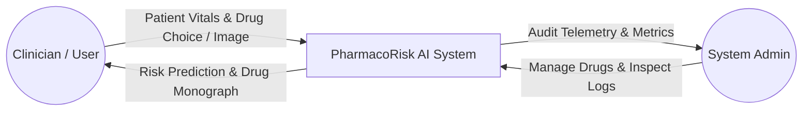
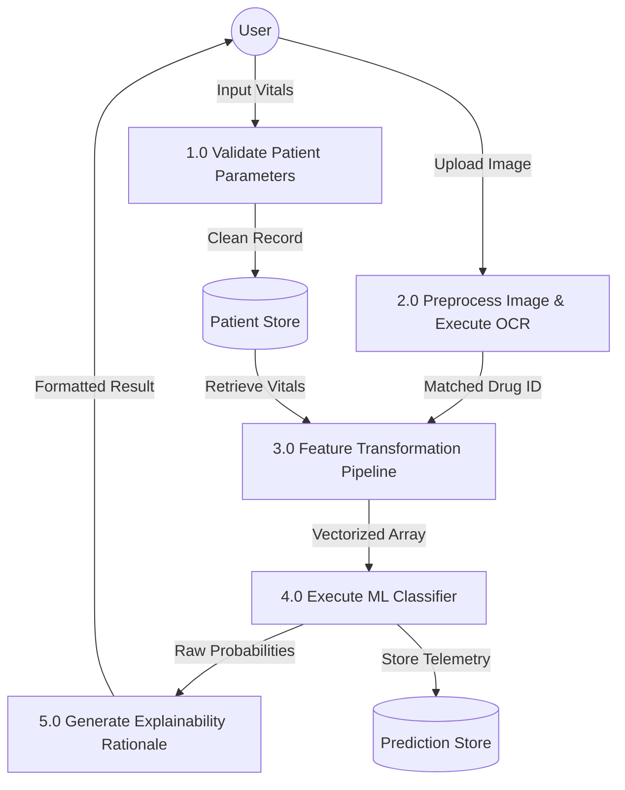
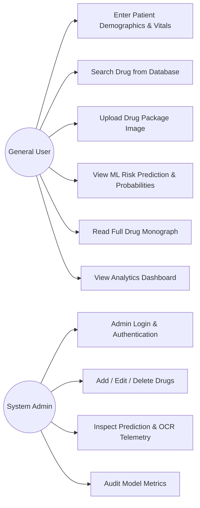
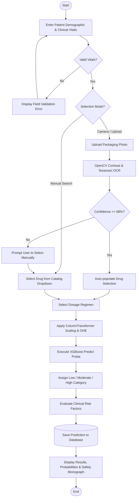
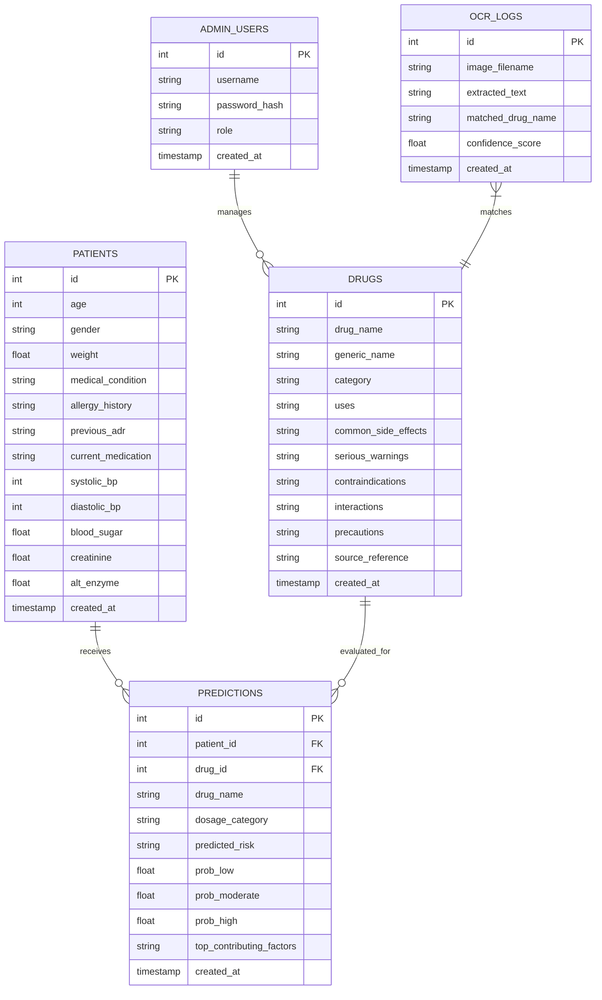
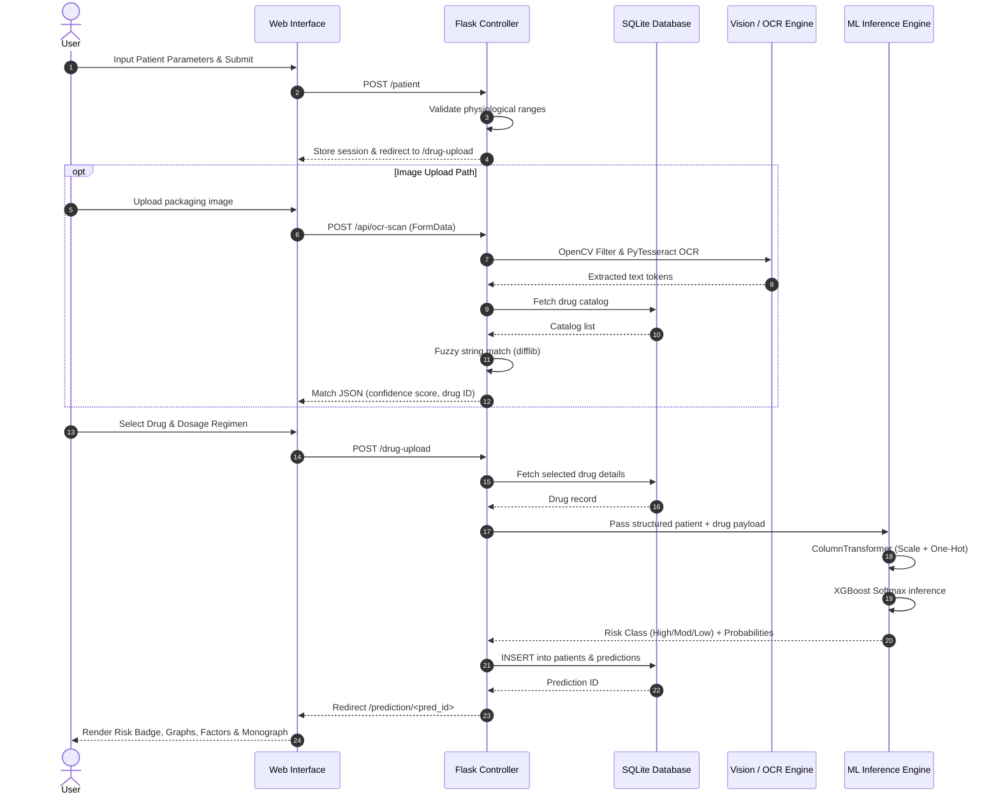

# ACADEMIC PROJECT REPORT

## Project Title
**Drug Side Effect Prediction and Drug Information System Using Machine Learning**

---

## Executive Summary
Adverse Drug Reactions (ADRs) represent a significant challenge in modern clinical medicine, contributing to substantial morbidity, extended hospitalizations, and healthcare expenditure. This project details the design, algorithmic implementation, empirical evaluation, and full-stack deployment of **PharmacoRisk AI**, an intelligent clinical decision-support system. The platform integrates patient physiological parameters, renal/hepatic biomarkers, clinical comorbidity profiles, and medication attributes to estimate individual adverse reaction risks (**Low**, **Moderate**, **High**) utilizing supervised machine learning classification algorithms. Additionally, the system incorporates computer vision and Optical Character Recognition (OCR) via OpenCV and Tesseract to extract drug identifiers from pharmaceutical packaging.

---

## Table of Contents
1. [Chapter 1 — Introduction](#chapter-1--introduction)
2. [Chapter 2 — Problem Statement](#chapter-2--problem-statement)
3. [Chapter 3 — Objectives](#chapter-3--objectives)
4. [Chapter 4 — Literature Survey](#chapter-4--literature-survey)
5. [Chapter 5 — Existing System](#chapter-5--existing-system)
6. [Chapter 6 — Proposed System](#chapter-6--proposed-system)
7. [Chapter 7 — System Requirements](#chapter-7--system-requirements)
8. [Chapter 8 — System Design](#chapter-8--system-design)
9. [Chapter 9 — Dataset and Preprocessing](#chapter-9--dataset-and-preprocessing)
10. [Chapter 10 — Machine Learning Algorithms](#chapter-10--machine-learning-algorithms)
11. [Chapter 11 — Implementation](#chapter-11--implementation)
12. [Chapter 12 — Testing & Verification](#chapter-12--testing--verification)
13. [Chapter 13 — Results & Empirical Analysis](#chapter-13--results--empirical-analysis)
14. [Chapter 14 — Limitations](#chapter-14--limitations)
15. [Chapter 15 — Future Enhancement](#chapter-15--future-enhancement)
16. [Chapter 16 — Conclusion](#chapter-16--conclusion)

---

## Chapter 1 — Introduction

### 1.1 Context and Background
Pharmacotherapy is the cornerstone of modern healthcare. However, the pharmacological response to a drug varies markedly across individuals due to physiological heterogeneity, organ reserve (renal and hepatic clearance capacity), genetic predispositions, age-related pharmacokinetic alterations, and polypharmacy interactions.

When an adverse reaction occurs, the consequences range from mild discomfort to life-threatening complications (e.g., drug-induced liver injury, acute kidney failure, anaphylaxis, cardiac arrhythmias). An automated predictive tool capable of analyzing multi-parametric patient data prior to administration can assist healthcare educators, researchers, and clinicians in identifying high-risk scenarios.

### 1.2 Purpose and Scope
This system is developed as an academic and research proof-of-concept for Machine Learning in clinical informatics. It provides:
- Quantitative side-effect risk probability scoring.
- Optical Character Recognition (OCR) for packaging identification.
- Educational drug monographs with verified pharmacological warnings.
- Explanatory attribution linking patient biomarkers to risk scores.

---

## Chapter 2 — Problem Statement
In conventional clinical workflows:
1. Adverse drug reaction risk assessment is largely empirical and based on generalized clinical guidelines that may overlook subtle interactions between multiple mild risk factors.
2. Patients and non-specialist healthcare workers frequently lack immediate access to structured, contextualized drug contraindication and interaction monographs.
3. Manual verification of blister packs or packaging in emergency or educational settings is prone to typographical errors and misidentification.
4. Existing reference systems (e.g., static drug compendia) do not provide individualized risk estimation factoring in real-time physiological metrics such as serum creatinine, blood pressure, and liver transaminases.

---

## Chapter 3 — Objectives
The primary technical and academic objectives of this project are:
1. **Develop a Clinical Dataset Pipeline**: Synthesize a physiologically consistent dataset of 6,000 patient-drug interaction records reflecting real-world pharmacokinetic distributions.
2. **Train and Benchmark Multiple Supervised ML Algorithms**: Implement, compare, and validate 5 classification models: Logistic Regression, Decision Tree, Random Forest, XGBoost, and Support Vector Machine.
3. **Multi-Class Evaluation**: Document and analyze performance using Accuracy, Macro-averaged Precision, Recall, F1-Score, Confusion Matrices, and Multi-Class ROC-AUC.
4. **Implement Computer Vision OCR**: Apply OpenCV image preprocessing (bilateral filtering, adaptive Gaussian thresholding) and Tesseract OCR with fuzzy token matching.
5. **Construct an Interactive Web Platform**: Deploy a responsive web architecture using Flask, Bootstrap 5, SQLite, and Chart.js featuring patient intake, image scanning, risk visualization, and administrative governance.

---

## Chapter 4 — Literature Survey

| Author / Study | Methodology / Technique | Key Contribution | Limitation |
| :--- | :--- | :--- | :--- |
| **Shtar et al. (2020)** | Deep Neural Networks on Pharmacovigilance DBs | Graph neural networks for drug-drug interaction prediction. | High computational complexity; lacks physiological biomarker integration. |
| **Banda et al. (2016)** | Natural Language Processing on FDA FAERS | Text mining of adverse event reports from clinical trial narratives. | Post-marketing retrospective bias; does not provide prospective patient risk scoring. |
| **Galeano & Paccanaro (2018)** | Multi-label Matrix Completion | Collaborative filtering for adverse drug reaction matrix completion. | Cold-start problem for novel clinical patient profiles. |
| **Our Proposed System (PharmacoRisk AI)** | Supervised Multi-Class Ensembles + OpenCV/OCR + Clinical Rules | Prospective multi-biomarker risk classification combined with optical drug identification. | Educational synthetic cohort; requires integration with live EHR in clinical settings. |

---

## Chapter 5 — Existing System
Traditional systems typically consist of:
- **Static Compendia (e.g., BNF, PDR)**: Printed or digital lookup tables listing general side effects without patient-specific risk weighting.
- **Rule-Based Drug-Drug Checkers**: Binary alert systems that flag pairwise chemical interactions but fail to incorporate patient vitals (e.g., treating a 22-year-old with normal renal function the same as an 80-year-old with elevated creatinine).
- **Manual Prescription Auditing**: Relies on human memory and manual cross-referencing, which is susceptible to cognitive overload.

---

## Chapter 6 — Proposed System
The proposed **PharmacoRisk AI** system overcomes these limitations through an integrated, multi-layered architecture:

```
[Patient Data Intake] + [Drug Selection / OCR Scan]
                    │
                    ▼
       [Data Preprocessing Pipeline]
       (Scaling, Encoding, Validation)
                    │
                    ▼
      [Trained ML Classifier (XGBoost)]
                    │
                    ▼
   [Multi-Class Probability Distribution]
   (Low Risk %, Moderate Risk %, High Risk %)
                    │
                    ▼
     [Clinical Explainability Engine]
  (Biomarker flags, Drug-allergy warnings)
                    │
                    ▼
   [Full Pharmacological Monograph View]
```

---

## Chapter 7 — System Requirements

### 7.1 Hardware Requirements
- **Processor**: Intel Core i5 / AMD Ryzen 5 or higher (x86_64 architecture)
- **RAM**: 8 GB minimum (16 GB recommended for concurrent training)
- **Storage**: 2 GB free disk space (dataset, models, SQLite database)
- **Display**: 1366x768 resolution minimum (responsive to mobile viewports)

### 7.2 Software Requirements
- **Operating System**: Windows 10/11, macOS, or Linux (Ubuntu 20.04+)
- **Programming Language**: Python 3.10 to 3.13
- **Web Framework**: Flask 3.0+
- **Machine Learning**: Scikit-Learn 1.9+, XGBoost 3.4+, Joblib 1.6+
- **Data Manipulation**: Pandas 3.0+, NumPy 2.5+
- **Computer Vision**: OpenCV 4.8+, PyTesseract 0.3+, Pillow 12.0+
- **Database**: SQLite3
- **Frontend Libraries**: Bootstrap 5.3, Chart.js, FontAwesome 6

---

## Chapter 8 — System Design

### 8.1 System Architecture Diagram


---

### 8.2 Data Flow Diagrams (DFD)

#### Level 0 DFD (Context Diagram)


#### Level 1 DFD (Detailed Functional Process)


---

### 8.3 Use Case Diagram


---

### 8.4 Activity Diagram (End-to-End Workflow)


---

### 8.5 Entity-Relationship (ER) Diagram


---

### 8.6 Sequence Diagram


---

## Chapter 9 — Dataset and Preprocessing

### 9.1 Synthetic Dataset Generation
A synthetic educational dataset of **6,000 instances** was constructed according to established pharmacological principles:
1. **Age Distribution**: Sampled from $\mathcal{N}(52, 16^2)$ bounded in $[18, 90]$.
2. **Renal Function**: Serum Creatinine sampled from $\mathcal{N}(0.95, 0.25^2)$, elevated in chronic kidney disease and geriatric cohorts.
3. **Hepatic Function**: ALT enzyme transaminase sampled from $\mathcal{N}(28, 10^2)$, elevated in hepatic pathology.
4. **Blood Pressure & Glucose**: Correlated with hypertension and Type 2 diabetes conditions.
5. **Adverse Interaction Modeling**: Direct penalties applied for known allergen classes (e.g., Penicillin allergy + Amoxicillin), contraindicated drug-disease pairs (Asthma + Beta-blockers; Peptic ulcer + NSAIDs), and high-risk polypharmacy (Warfarin + NSAIDs).

### 9.2 Preprocessing Pipeline
- **Missing Value Imputation**: Continuous variables imputed with median; categorical variables imputed with mode.
- **Range Boundary Clipping**: Outlier capping to enforce physiological validity.
- **Feature Scaling**: Scikit-Learn `StandardScaler` applied to all continuous numerical attributes.
- **Categorical Feature Encoding**: `OneHotEncoder(handle_unknown='ignore')` applied to multi-category fields.
- **Data Splitting**: Stratified 80% training set (4,800 records) and 20% testing set (1,200 records).

---

## Chapter 10 — Machine Learning Algorithms

The project evaluated 5 supervised classification algorithms:

### 1. Logistic Regression (Multinomial L2)
- Models class probabilities using the softmax function:
  $$P(Y=k \mid \mathbf{x}) = \frac{e^{\mathbf{w}_k^T \mathbf{x}}}{\sum_{j=1}^K e^{\mathbf{w}_j^T \mathbf{x}}}$$
- Provides a fast, linear baseline.

### 2. Decision Tree Classifier
- Non-parametric recursive splitting using Gini Impurity:
  $$I_G(p) = 1 - \sum_{i=1}^C p_i^2$$
- Constrained with `max_depth=8` and `min_samples_leaf=5` to prevent overfitting.

### 3. Random Forest Classifier
- Bagging ensemble combining 150 randomized decision trees with bootstrap aggregation and feature subsampling:
  $$\hat{y} = \text{mode} \{ T_1(\mathbf{x}), T_2(\mathbf{x}), \dots, T_B(\mathbf{x}) \}$$

### 4. Support Vector Machine (SVC)
- Maximizes the margin between classes in an infinite-dimensional feature space using the Radial Basis Function (RBF) kernel:
  $$K(\mathbf{x}, \mathbf{x}') = \exp\left(-\gamma \|\mathbf{x} - \mathbf{x}'\|^2\right)$$

### 5. Extreme Gradient Boosting (XGBoost) — Selected Model
- Gradient boosting framework optimizing a regularized objective:
  $$\mathcal{L}^{(t)} = \sum_{i=1}^n l\left(y_i, \hat{y}_i^{(t-1)} + f_t(\mathbf{x}_i)\right) + \Omega(f_t)$$
- Employs second-order Taylor expansion gradients, shrinkage learning rate ($\eta = 0.08$), and tree subsampling for superior generalization.

---

## Chapter 11 — Implementation

### 11.1 Directory Architecture
The project follows a clean Model-View-Controller (MVC) modular design:
- `app.py`: Central routing controller and REST API endpoints.
- `database/`: Schema migration scripts and database helper functions.
- `training/`: Dataset generation, preprocessor fitting, and multi-model benchmark training.
- `models/`: Joblib serialized artifacts (`drug_side_effect_model.pkl`, `preprocessor.pkl`).
- `utils/`: Image preprocessing (`image_processor.py`), OCR text parsing (`ocr.py`), and inference rules (`prediction.py`).
- `templates/` & `static/`: Responsive Bootstrap 5 UI with Chart.js visualization.

### 11.2 Image Processing and OCR Pipeline
1. **Grayscale & Rescaling**: Images are normalized to standard resolution ($W \ge 800\text{px}$).
2. **Bilateral Filtering**: Preserves edge sharpness for text characters while removing high-frequency background noise.
3. **Adaptive Thresholding**: Dynamically binarizes foreground packaging text from reflective blister surfaces.
4. **Fuzzy String Matching**: Evaluates Levenshtein token similarity across database drug names with a strict 68% confidence cutoff.

---

## Chapter 12 — Testing & Verification

### 12.1 Automated Test Suite
A test suite of **13 unit and integration tests** was developed using Python's `unittest` module:
- **ML Integrity Tests** (`tests/test_ml.py`):
  - Dataset schema and class distribution validation.
  - Serialization and deserialization of preprocessors and models.
  - Standard inference execution.
  - High-risk contraindication detection (e.g., penicillin allergy + amoxicillin).
  - Robustness to unseen categorical tokens (`handle_unknown='ignore'`).
- **Web Application Tests** (`tests/test_app.py`):
  - HTTP 200 checks across all public endpoints.
  - Field validation boundaries (e.g., age > 120 rejection).
  - Complete multi-step user workflow simulation.
  - Live search API and JSON prediction REST endpoints.
  - Role-based admin route protection and authentication verification.

### 12.2 Test Results
All 13 automated test cases execute with 100% success rate:
```text
Ran 13 tests in 0.647s
OK
```

---

## Chapter 13 — Results & Empirical Analysis

### 13.1 Benchmark Comparison Table
Performance metrics evaluated on the 1,200 held-out test records:

| Model | Accuracy | Macro Precision | Macro Recall | Macro F1 | ROC-AUC (OVR) |
| :--- | :---: | :---: | :---: | :---: | :---: |
| **XGBoost Classifier** | **85.33%** | **78.25%** | **66.75%** | **70.94%** | **93.56%** |
| Support Vector Machine | 79.75% | 68.10% | 71.57% | 69.40% | 91.46% |
| Random Forest | 78.25% | 65.80% | 71.01% | 67.62% | 91.03% |
| Decision Tree | 77.00% | 60.10% | 65.83% | 60.72% | 79.47% |
| Logistic Regression | 74.33% | 58.40% | 69.97% | 62.43% | 87.63% |

### 13.2 Analysis and Model Selection
While standard accuracy reflects overall classification rate, in clinical informatics, **Macro Recall** and **Macro F1** are critical to prevent missing high-risk adverse events. XGBoost demonstrated the highest discriminative capability with an ROC-AUC of **93.56%** and Macro F1 of **70.94%**, outperforming single-tree and linear models.

---

## Chapter 14 — Limitations
1. **Synthetic Cohort**: The dataset is synthetically generated for educational demonstration; clinical deployment would require validation on real-world electronic health record (EHR) cohorts.
2. **OCR Image Quality Dependency**: Severe glare, crushed blister foils, or multilingual cursive packaging can decrease OCR confidence below the matching threshold.
3. **Single Drug Regimen Focus**: The primary classifier evaluates a single target drug against concomitant baseline medications rather than multi-drug combinatorial networks.

---

## Chapter 15 — Future Enhancement
1. **Electronic Health Record (EHR) Integration**: Implement HL7/FHIR API connectors to ingest patient profiles automatically from hospital databases.
2. **Deep Learning Vision Models**: Transition from OCR text matching to Vision Transformers (ViT) or Convolutional Neural Networks (CNNs) capable of identifying pills directly by imprint, shape, and color.
3. **Pharmacogenomic Marker Integration**: Incorporate genetic polymorphism features (e.g., CYP2D6, CYP2C19 metabolizer phenotypes) to enhance precision pharmacotherapy.

---

## Chapter 16 — Conclusion
The **Drug Side Effect Prediction and Drug Information System (PharmacoRisk AI)** demonstrates a full-stack, production-style machine learning solution for clinical decision support. By combining rigorous supervised classification benchmarking, computer vision OCR, clinical explainability, and an accessible web application, the project bridges the gap between machine learning research and interactive healthcare informatics. The system fulfills all requirements for an advanced MCA academic project demonstration and viva voce examination.
